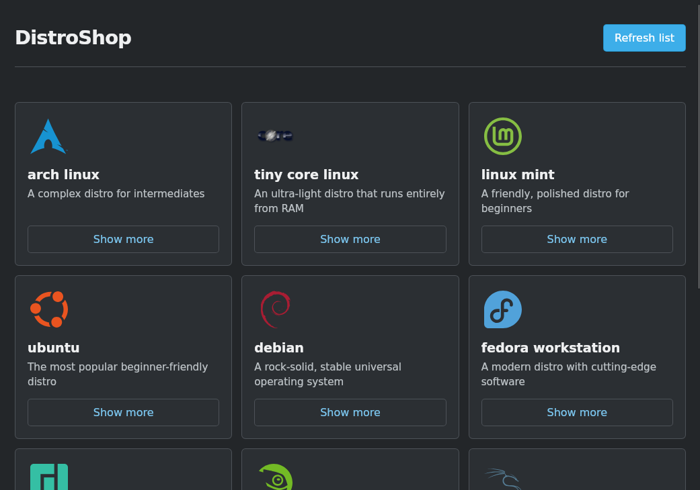

# DistroShop


A small desktop app for browsing distro images, testing them in a VM, and flashing them to a USB stick.


## What it does

- Shows a list of Linux distros from a remote JSON catalog
- Displays each distro's image, summary, and full description
- Downloads the selected ISO
- Boots up a Virtual Machine running the ISO
- Flashes the ISO to a chosen block device
- Offers a `safe` and `fast` flash mode (streaming the file little by little or loading the entire iso into memory and then writing to disk)

## Current status

The app is being developed mainly for Linux, hence why only those binaries are built.
Mileage with non-Linux builds may vary.


## Requirements

- Rust and Cargo (if compiling from source)
- qemu-system (automatically included on flatpak)
- A target USB device 
- A graphical desktop environment

## Running the app

I recommend using the prebuilt binary or the flatpak, but you can also run it  with cargo:

```bash
cargo run
```

If you want the Dioxus dev workflow instead of the plain desktop app:

```bash
dx serve
```

## Building the Flatpak

The Flatpak manifest is `io.github.techcore3.distroshop.yml`. Its Cargo dependencies are pinned in `cargo-sources.json`; regenerate that file whenever `Cargo.lock` changes using `flatpak-cargo-generator.py Cargo.lock -o cargo-sources.json`.

With Flatpak Builder and the GNOME 50 runtime and Rust extension installed, build with:

```bash
flatpak-builder --force-clean build-dir io.github.techcore3.distroshop.yml
```

## Flashing safely

Before flashing, double-check the target device path.

The app writes directly to the selected block device. Make sure you are targeting the USB stick, not your system drive.

## Project layout

```text
src/
├── main.rs            # app entry point and launch logic
├── list_handler.rs    # distro catalog loading, caching, and UI
├── distro_testing/    # VM-based testing of distro images
│   ├── mod.rs
│   └── vm_handler.rs  # VM setup and test runs
└── flashing/          # download + flashing logic
    ├── mod.rs
    ├── flash_handler.rs
    ├── flasher_unix.rs
    ├── flasher_win.rs
    └── udisks2_wrapper.rs  # UDisks2 integration for Linux disk access
assets/
├── distros.json       # distro catalog used by the app
├── logo.png           # app favicon (works on everything except wayland)
├── screenshot*.png    # AppStream screenshots
└── main.css           # styling
```

## License

GPL-3.0-only; see [LICENSE](LICENSE).
